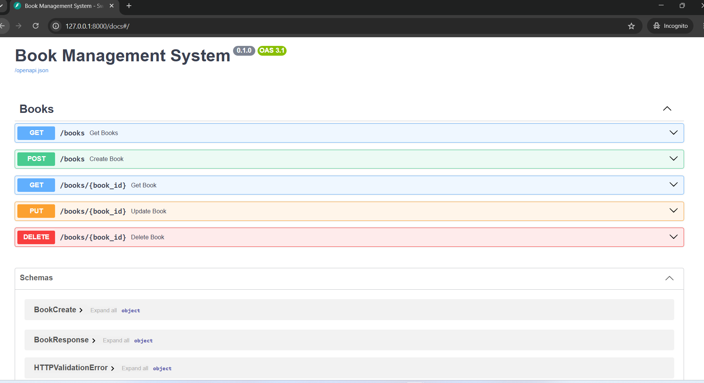
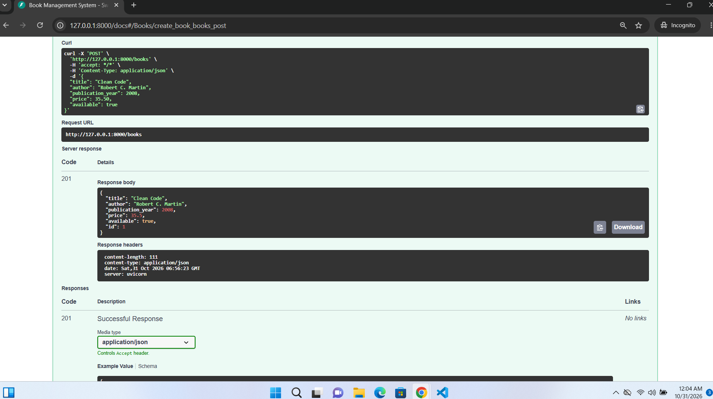
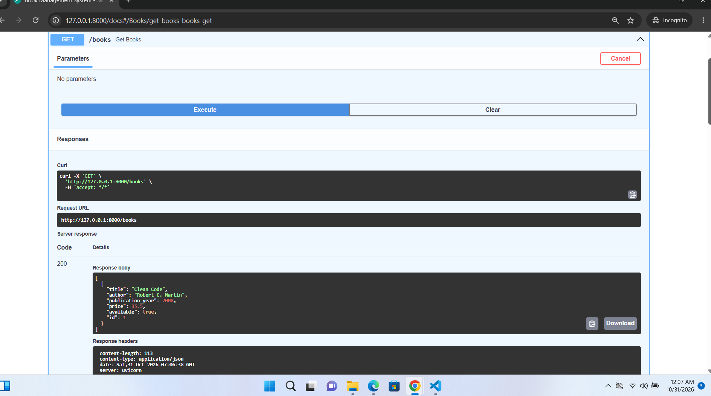
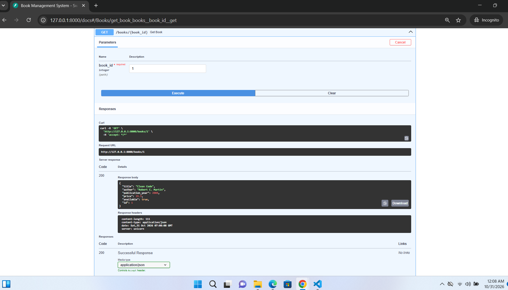
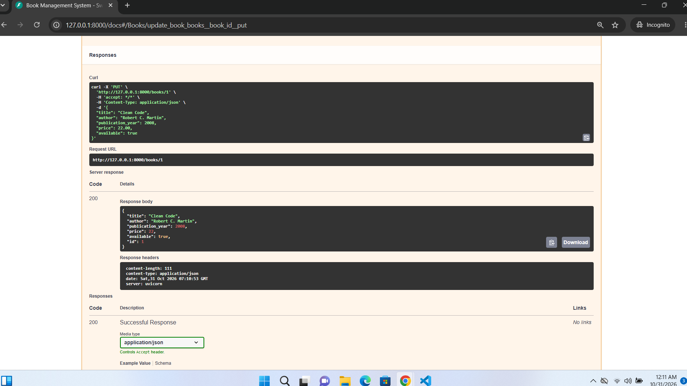
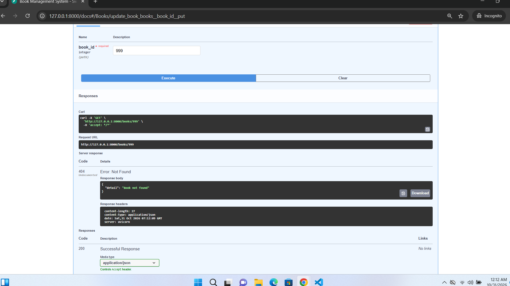
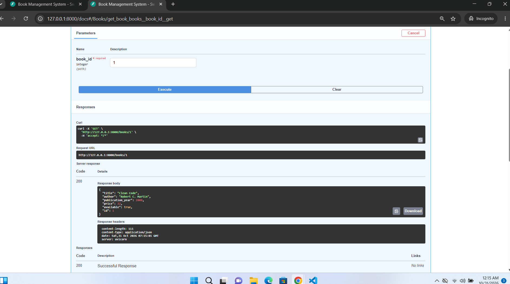
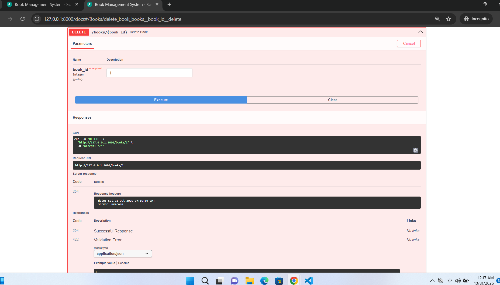
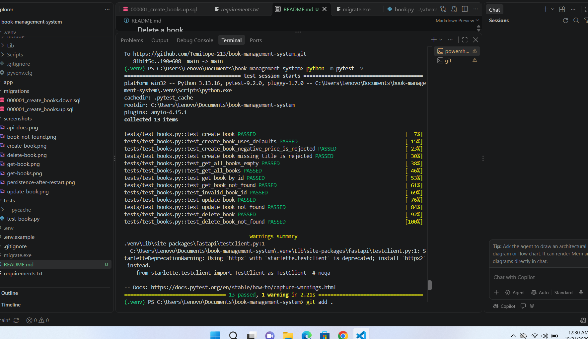

# Book Management System

## Project Description and Features
The Book Management System is a REST API built with Python and FastAPI. It lets users create, view, update, and delete books. All books are stored in a PostgreSQL database hosted on Neon, so the data stays available after the application restarts.

Features:
- Create, retrieve, update, and delete books
- Data stored in PostgreSQL (Neon), with the ID generated by the database
- Request validation with Pydantic
- Database schema managed with migration files
- Parameterized SQL queries (no SQL built from user input)
- Safe error handling that never exposes credentials or internal database errors
- Automated API tests
- Interactive API documentation at `/docs`

## Technologies Used
- Python
- FastAPI
- PostgreSQL (hosted on Neon)
- Psycopg 3
- Pydantic
- Uvicorn
- golang-migrate (database migrations)
- Pytest and HTTPX (testing)

## Project Folder Structure
```
book-management-system/
├── app/
│   ├── __init__.py
│   ├── main.py
│   ├── database/
│   │   ├── __init__.py
│   │   └── connection.py
│   ├── models/
│   │   ├── __init__.py
│   │   └── book.py
│   ├── routes/
│   │   ├── __init__.py
│   │   └── books.py
│   └── schemas/
│       ├── __init__.py
│       └── book.py
├── migrations/
│   ├── 000001_create_books.up.sql
│   └── 000001_create_books.down.sql
├── tests/
│   └── test_books.py
├── screenshots/
├── .env.example
├── .gitignore
├── requirements.txt
└── README.md
```

- `main.py` creates the FastAPI app and registers the routes.
- `database/connection.py` manages the database connection.
- `models/book.py` contains the database operations for books.
- `routes/books.py` defines the API endpoints.
- `schemas/book.py` defines the Pydantic schemas for validation.
- `migrations/` contains the database migration files.
- `tests/test_books.py` contains the automated tests.

## Installation and Setup
1. Clone the repository:
   ```
   git clone https://github.com/Temitope-213/book-management-system.git
   ```
2. Go into the project folder:
   ```
   cd book-management-system
   ```
3. Create a virtual environment:
   ```
   python -m venv .venv
   ```
4. Activate it:
   - Windows (PowerShell): `.venv\Scripts\Activate.ps1`
   - Mac/Linux: `source .venv/bin/activate`
5. Install the dependencies:
   ```
   pip install -r requirements.txt
   ```
6. Create a free PostgreSQL database on [Neon](https://neon.com) and copy its connection string.

## Environment Variables
The app reads its database connection string from a `.env` file, which is never committed to GitHub.

1. Copy the example file:
   - Windows: `copy .env.example .env`
   - Mac/Linux: `cp .env.example .env`
2. Open `.env` and replace the placeholder with your own Neon connection string:
   ```
   DATABASE_URL=your_neon_connection_string
   ```

Never commit your real `.env` file or your connection string.

## Database Migrations
The `books` table is created by migration files in the `migrations/` folder:
- `000001_create_books.up.sql` creates the table
- `000001_create_books.down.sql` removes it

Migrations are applied with [golang-migrate](https://github.com/golang-migrate/migrate), which also keeps track of which migrations have run.

1. Download `migrate.windows-amd64.zip` (or the version for your system) from the [golang-migrate releases page](https://github.com/golang-migrate/migrate/releases).
2. Put `migrate.exe` in the project's main folder.
3. Apply the migration:
   ```
   .\migrate.exe -path migrations -database "YOUR_NEON_CONNECTION_STRING" up
   ```
   If your connection string ends with `&channel_binding=require`, remove that part when passing it to `migrate`.

Alternative that reads the link from your `.env` file, so you don't type it:

```
python -c "import os,subprocess; from dotenv import load_dotenv; load_dotenv(); subprocess.run(['.\\migrate.exe','-path','migrations','-database',os.getenv('DATABASE_URL').replace('&channel_binding=require',''),'up'])"
```

To undo the last migration, use `down 1` instead of `up`.

## Running the Application
Start the server:

```
python -m uvicorn app.main:app --reload
```

The API runs at http://127.0.0.1:8000. The interactive documentation is at http://127.0.0.1:8000/docs. Press `Ctrl+C` in the terminal to stop the server.

## Running the Tests
```
python -m pytest -v
```

The tests use FastAPI's `TestClient` and replace the database functions with a fake in-memory store. This means the tests do not connect to Neon and do not need a `.env` file. They cover creating, listing, retrieving, updating, and deleting books, plus validation errors and 404 responses (13 tests).

## API Endpoint Documentation

| Method | Endpoint | Description | Success | Errors |
|--------|----------|-------------|---------|--------|
| POST | `/books` | Create a book | 201 Created | 422 invalid data |
| GET | `/books` | List all books (empty array if none) | 200 OK | |
| GET | `/books/{book_id}` | Get one book | 200 OK | 404 not found, 422 invalid ID |
| PUT | `/books/{book_id}` | Update a book (send all required fields) | 200 OK | 404 not found, 422 invalid data |
| DELETE | `/books/{book_id}` | Delete a book | 204 No Content | 404 not found |

### Book fields
| Field | Type | Rules |
|-------|------|-------|
| `id` | integer | Generated by the database |
| `title` | string | Required, maximum 200 characters |
| `author` | string | Required, maximum 150 characters |
| `publication_year` | integer | Optional |
| `price` | number | Required, 0 or more |
| `available` | boolean | Defaults to `true` |

### Example request body (POST and PUT)
```json
{
  "title": "Clean Code",
  "author": "Robert C. Martin",
  "publication_year": 2008,
  "price": 35.50,
  "available": true
}
```

### Example response (201 Created)
```json
{
  "title": "Clean Code",
  "author": "Robert C. Martin",
  "publication_year": 2008,
  "price": 35.5,
  "available": true,
  "id": 1
}
```

### Error responses
- `404`: `{"detail": "Book not found"}`
- `422`: the request data or the book ID is invalid
- `503`: `{"detail": "Database unavailable"}`
- `500`: `{"detail": "Internal server error"}`

Database credentials and internal error details are never returned to the client.

## Screenshots

### API documentation


### Create a book


### Get all books


### Get a book by ID


### Update a book


### Book not found (404)


### Data still available after restarting the server


### Delete a book


### Automated tests passing
