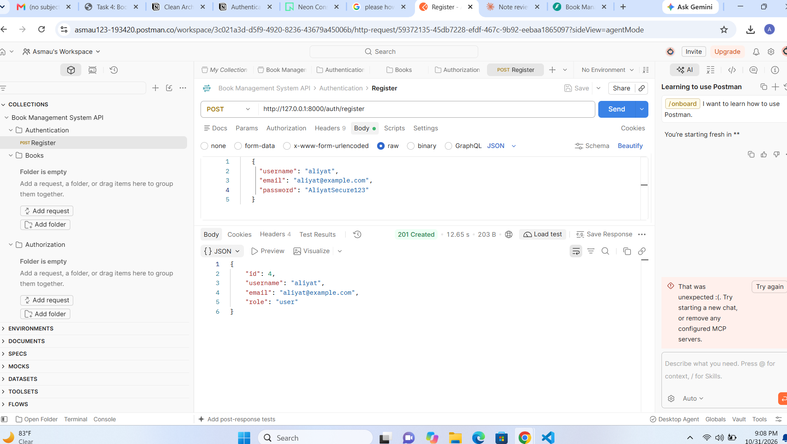
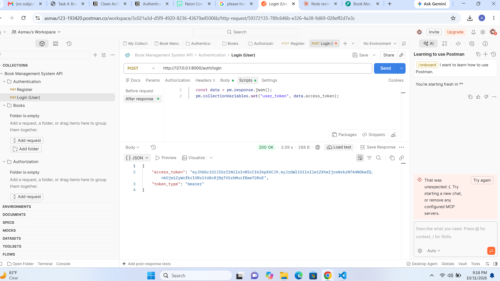
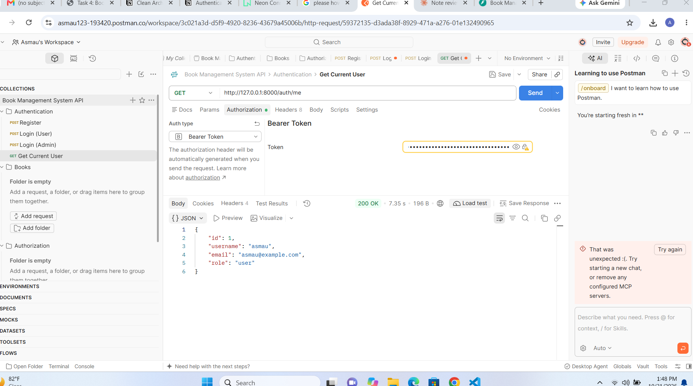
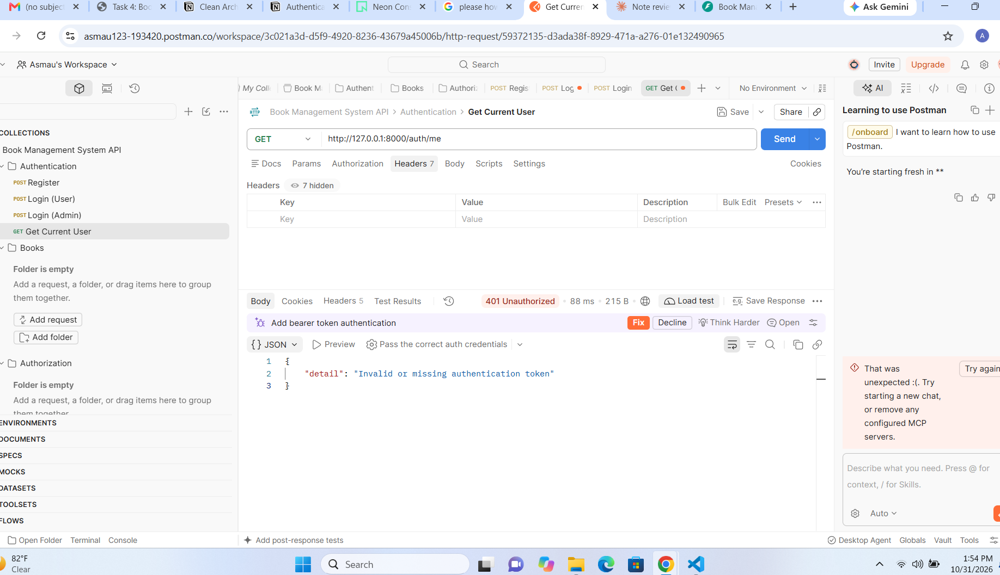
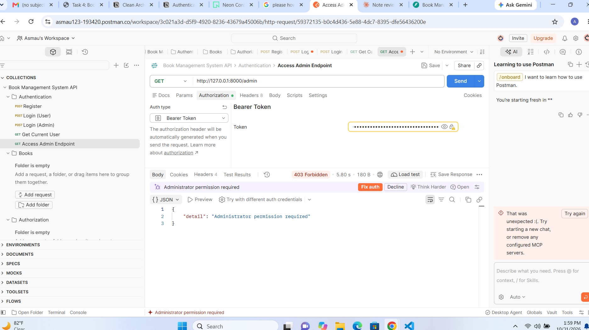
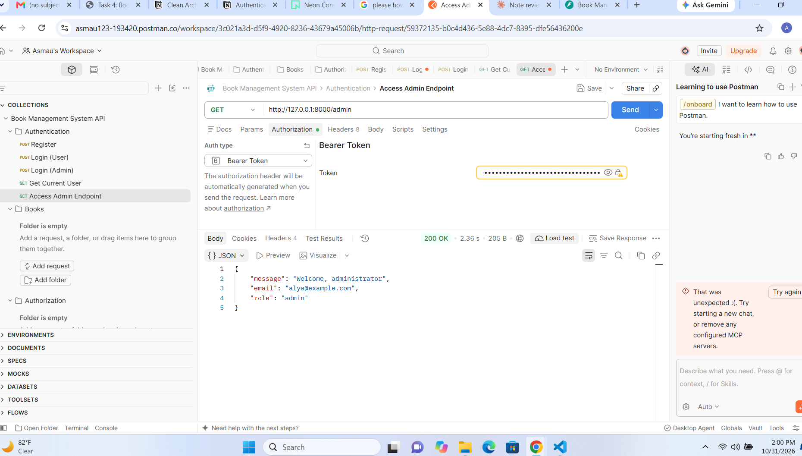
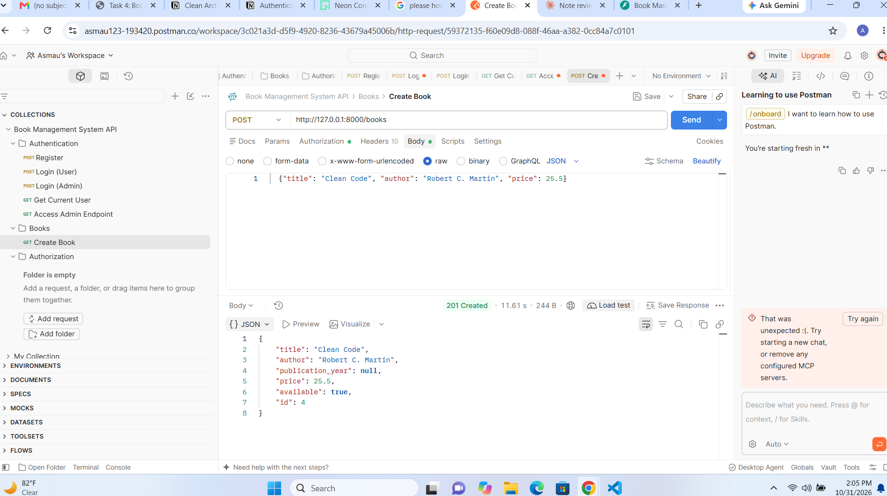
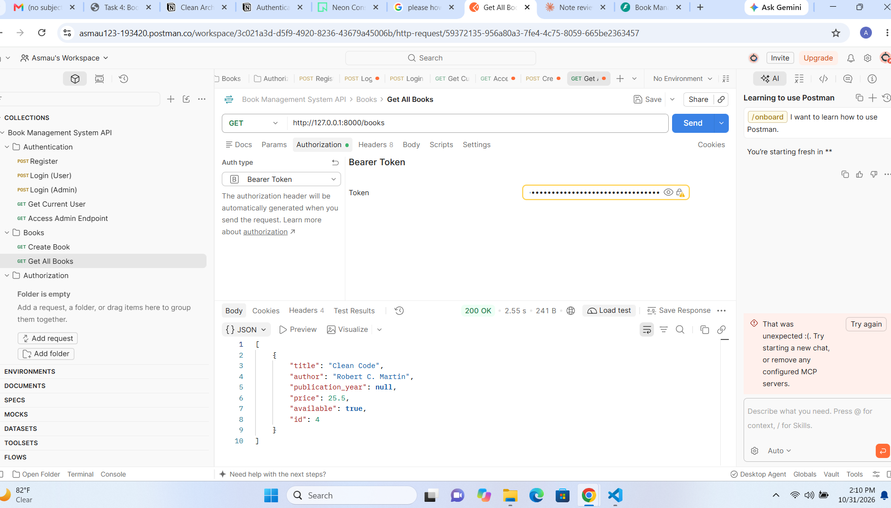
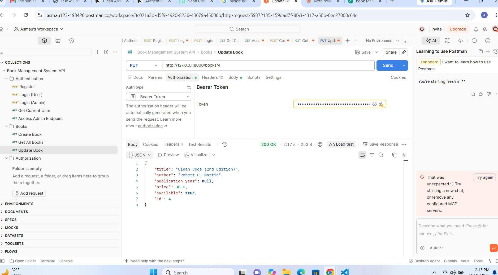
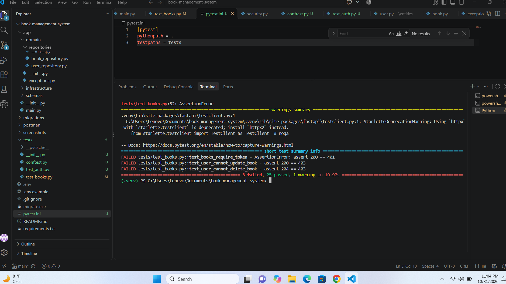

# Book Management System

## Project Description and Features
The Book Management System is a REST API built with Python and FastAPI. Users can register, log in, and manage books. Access is controlled by role-based authorization (`user` and `admin`). All data is stored in a PostgreSQL database hosted on Neon, so it stays available after the application restarts.

The project is organized using Clean Architecture, so business rules are separate from the web framework and the database.

Features:
- User registration and login with hashed passwords (Argon2id)
- JWT access tokens with an expiration time
- Role-based authorization (`user` and `admin`)
- Create, retrieve, update, and delete books
- Data stored in PostgreSQL (Neon), with IDs generated by the database
- Request validation with Pydantic, and business rules in the domain layer
- Database schema managed with migration files
- Parameterized SQL queries (no SQL built from user input)
- Safe error handling that never exposes credentials or internal database errors
- Automated tests that never touch the real database
- Exported Postman collection
- Interactive API documentation at `/docs`

## Technologies Used
- Python
- FastAPI
- PostgreSQL (hosted on Neon)
- Psycopg 3
- Pydantic
- Uvicorn
- PyJWT (JSON Web Tokens)
- pwdlib with Argon2 (password hashing)
- python-dotenv
- golang-migrate (database migrations)
- Pytest and HTTPX (testing)
- Postman (manual API testing)

## Architecture and Folder Structure
```
book-management-system/
├── app/
│   ├── main.py                     # App setup, routers, error handlers
│   ├── core/                       # Configuration and security (hashing, JWT)
│   ├── domain/
│   │   ├── entities/               # Book and User, with business rules
│   │   ├── repositories/           # Repository interfaces (abstract)
│   │   └── exceptions.py           # Domain errors
│   ├── application/use_cases/      # RegisterUser, LoginUser, CreateBook, ...
│   ├── infrastructure/database/    # PostgreSQL connection and repositories
│   ├── schemas/                    # Pydantic request/response models
│   └── api/
│       ├── dependencies.py         # Auth checks and use case wiring
│       └── routes/                 # auth, books, admin
├── migrations/                     # SQL migration files
├── tests/                          # Automated tests
├── postman/                        # Exported Postman collection
├── screenshots/               # Screenshots for this README
├── .env.example
├── .gitignore
├── requirements.txt
└── README.md
```

| Layer | Responsibility |
|---|---|
| Domain | Core concepts and business rules (for example, a price cannot be negative). Does not depend on FastAPI or PostgreSQL. |
| Application | Use cases that coordinate operations, such as registering a user or creating a book. They depend on repository interfaces only. |
| Infrastructure | PostgreSQL connection and concrete repositories using parameterized SQL. |
| Schemas | Pydantic models that validate request and response data. |
| API | Handles HTTP requests and responses, and applies authentication and role checks. |
| Core | Configuration, password hashing, and JWT creation and verification. |

Dependencies point inward. Use cases depend on repository interfaces, and the PostgreSQL implementations are plugged in from the outside through FastAPI dependencies. This is why the tests can swap in in-memory fakes without changing any business logic.

## Installation and Setup
1. Clone the repository:
   ```
   git clone https://github.com/Temitope-213/book-management-system.git
   ```
2. Go into the project folder:
   ```
   cd book-management-system
   ```
3. Create a virtual environment:
   ```
   python -m venv .venv
   ```
4. Activate it:
   - Windows (PowerShell): `.venv\Scripts\Activate.ps1`
   - Mac/Linux: `source .venv/bin/activate`
5. Install the dependencies:
   ```
   pip install -r requirements.txt
   ```
6. Create a free PostgreSQL database on [Neon](https://neon.com) and copy its connection string.

## Environment Variables
The app reads its settings from a `.env` file, which is never committed to GitHub.

1. Copy the example file:
   - Windows: `copy .env.example .env`
   - Mac/Linux: `cp .env.example .env`
2. Open `.env` and replace the placeholders with your own values:
   ```
   DATABASE_URL=your_neon_connection_string
   JWT_SECRET_KEY=your_random_secret_key
   ```
3. Generate a secret key with:
   ```
   python -c "import secrets; print(secrets.token_hex(32))"
   ```

Never commit your real `.env` file, your connection string, or your secret key.

## Database Migrations
The tables are created by migration files in the `migrations/` folder:
- `000001_create_books.up.sql` / `.down.sql`: creates / removes the `books` table
- `000002_create_users.up.sql` / `.down.sql`: creates / removes the `users` table

Migrations are applied with [golang-migrate](https://github.com/golang-migrate/migrate), which also keeps track of which migrations have run. If `000001` was already applied in the previous task, `up` applies only the new users migration.

1. Download `migrate.windows-amd64.zip` (or the version for your system) from the [golang-migrate releases page](https://github.com/golang-migrate/migrate/releases).
2. Put `migrate.exe` in the project's main folder.
3. Apply the migrations:
   ```
   .\migrate.exe -path migrations -database "YOUR_NEON_CONNECTION_STRING" up
   ```
   If your connection string ends with `&channel_binding=require`, remove that part when passing it to `migrate`.

Alternative that reads the link from your `.env` file, so you don't type it:

```
python -c "import os,subprocess; from dotenv import load_dotenv; load_dotenv(); subprocess.run(['.\\migrate.exe','-path','migrations','-database',os.getenv('DATABASE_URL').replace('&channel_binding=require',''),'up'])"
```

To undo the last migration, use `down 1` instead of `up`.

## Running the Application
Start the server:

```
python -m uvicorn app.main:app --reload
```

The API runs at http://127.0.0.1:8000. The interactive documentation is at http://127.0.0.1:8000/docs. Press `Ctrl+C` in the terminal to stop the server.

## Running the Tests
```
pip install pytest httpx
python -m pytest -v
```

The tests use FastAPI's `TestClient` and replace the PostgreSQL repositories with in-memory fakes. This means the tests never connect to Neon and never modify real data. They cover:
- Registration, duplicate emails, and invalid input
- Login, wrong passwords, and unknown emails
- Missing, invalid, and expired tokens
- Role-based authorization (user vs admin)
- Book create, read, update, and delete
- Invalid book data and nonexistent books

## Using the Postman Collection
1. Open Postman (use the **Desktop Agent**, so it can reach localhost).
2. Click **Import** and select `postman/book-management.postman_collection.json`.
3. Open the collection **Book Management System API** and go to its **Variables** tab. Set `base_url` to `http://127.0.0.1:8000`.
4. Run **Login (User)** and **Login (Admin)** in the Authentication folder. Their scripts save the tokens into `user_token` and `admin_token`.
5. Run the other requests. Authenticated requests use the Bearer Token `{{user_token}}` or `{{admin_token}}`.

The collection has three folders: Authentication, Books, and Authorization. It contains no real tokens or credentials.

## Authentication and Authorization

**Registration** (`POST /auth/register`)
- Input is validated, and each email must be unique (duplicates return 409).
- The password is hashed with Argon2id before storage. Plain-text passwords are never stored, and password hashes are never returned.
- New users always receive the `user` role. A role submitted in the request is ignored.

**Login** (`POST /auth/login`)
- The submitted password is verified against the stored hash.
- Invalid credentials return a generic 401 that does not reveal whether the email or the password was wrong.
- On success, a signed JWT (HS256) is returned. It contains the user ID (`sub`) and an expiration time (`exp`, 30 minutes). The signing key comes from the environment, and no secrets are placed in the token.

**Current user** (`GET /auth/me`)
- The token is sent as `Authorization: Bearer <token>`.
- Missing, invalid, tampered, or expired tokens return 401.

**Authorization**
- Authentication proves who you are. Authorization checks what you may do.
- Viewing and creating books require any valid user.
- Updating, deleting, and `GET /admin` require the `admin` role. A regular user receives **403 Forbidden**.

| Operation | User | Admin |
|---|---|---|
| View all books / one book | Yes | Yes |
| Create a book | Yes | Yes |
| Update a book | No (403) | Yes |
| Delete a book | No (403) | Yes |
| `GET /admin` | No (403) | Yes |

**Creating an admin**

Public registration can never create an admin. Register the user normally, then promote them in the Neon SQL Editor:

```sql
UPDATE users SET role = 'admin' WHERE email = 'admin@example.com';
```

The user must log in again to get a fresh token with the new role.

## API Endpoint Documentation

| Method | Endpoint | Description | Access | Success | Errors |
|--------|----------|-------------|--------|---------|--------|
| POST | `/auth/register` | Register a user | Public | 201 Created | 409 duplicate email, 422 invalid data |
| POST | `/auth/login` | Log in and get a token | Public | 200 OK | 401 invalid credentials |
| GET | `/auth/me` | Get the current user | Any user | 200 OK | 401 |
| GET | `/admin` | Admin-only endpoint | Admin | 200 OK | 401, 403 |
| POST | `/books` | Create a book | Any user | 201 Created | 401, 422 invalid data |
| GET | `/books` | List all books (empty array if none) | Any user | 200 OK | 401 |
| GET | `/books/{book_id}` | Get one book | Any user | 200 OK | 401, 404 not found, 422 invalid ID |
| PUT | `/books/{book_id}` | Update a book (send all required fields) | Admin | 200 OK | 401, 403, 404, 422 |
| DELETE | `/books/{book_id}` | Delete a book | Admin | 204 No Content | 401, 403, 404 |

### Book fields
| Field | Type | Rules |
|-------|------|-------|
| `id` | integer | Generated by the database |
| `title` | string | Required, maximum 200 characters |
| `author` | string | Required, maximum 150 characters |
| `publication_year` | integer | Optional |
| `price` | number | Required, 0 or more |
| `available` | boolean | Defaults to `true` |

### Example request body (POST and PUT)
```json
{
  "title": "Clean Code",
  "author": "Robert C. Martin",
  "publication_year": 2008,
  "price": 35.50,
  "available": true
}
```

### Example response (201 Created)
```json
{
  "title": "Clean Code",
  "author": "Robert C. Martin",
  "publication_year": 2008,
  "price": 35.5,
  "available": true,
  "id": 1
}
```

### Error responses
- `401`: missing, invalid, or expired token, or incorrect email or password
- `403`: `{"detail": "Administrator permission required"}`
- `404`: `{"detail": "Book not found"}`
- `409`: `{"detail": "Email is already registered"}`
- `422`: the request data or the book ID is invalid
- `503`: `{"detail": "Database unavailable"}`
- `500`: `{"detail": "Internal server error"}`

Database credentials and internal error details are never returned to the client.

## Screenshots

### Successful registration


### Successful login


### Request with an access token (`/auth/me`)


### Unauthorized request (no token)


### Regular user denied on the admin endpoint (403)


### Administrator accesses the admin endpoint


### Book CRUD

**Create**



**Get all**



**Update (admin)**



**Delete (admin)**


### Automated tests passing
